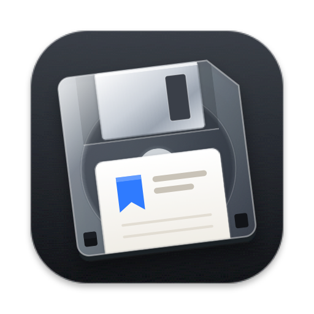

<p align="center"></p>

# stash

stash is a native SwiftUI app that archives your X bookmarks, likes, and their media on the Mac, and lets you search them and sort them into boards.

## Build

stash needs macOS 26 or later and the Swift 6.2 command line tools. Xcode isn't needed.

```sh
scripts/bundle.sh            # builds build/stash.app
scripts/bundle.sh --install  # also copies it to ~/Applications
swift test
```

## Use

Open stash and choose **Sync** (⌘R). A window for x.com appears only when you need to sign in. Turn on the six-hour background sync in Settings (⌘,).

Run the bundled executable from the command line.

```sh
~/Applications/stash.app/Contents/MacOS/stash sync
~/Applications/stash.app/Contents/MacOS/stash schedule on  # use off to remove the agent
```

New archives live in `~/Library/Application Support/stash`. Set `STASH_DIR` to use another folder.

If you used Mosaic or xsaves, stash opens your existing archive in place and reuses your X sign-in. It also recognizes `MOSAIC_DIR`, `XSAVES_DIR`, and existing sync schedules. To point your schedule at the installed stash app, run the `schedule on` command above.

## Icon

The icon's source is [`docs/design/app-icon/stash-icon.svg`](docs/design/app-icon/stash-icon.svg). After editing it, run `scripts/icon.sh` to regenerate `Resources/AppIcon.icns` and the PNG copies used here and in the wiki.

## Docs

Decisions, open questions, and the SwiftUI implementation plan are in [`docs/wiki`](docs/wiki/index.md).
