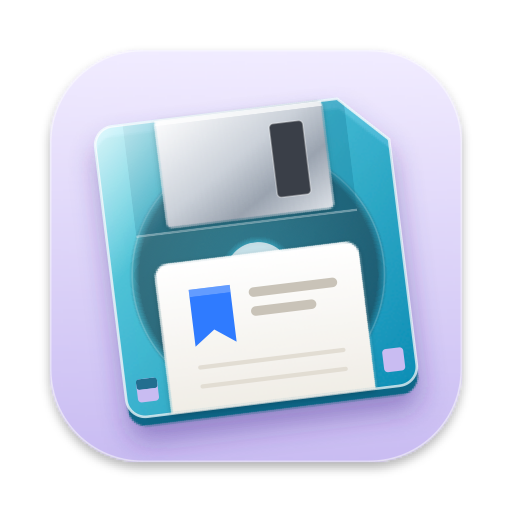

# Kaleidostash



Kaleidostash is a native SwiftUI app that archives your X bookmarks, likes, and their media on the Mac, and lets you search them and sort them into boards.

[Download for macOS](https://github.com/rengwu/kaleidostash/releases/latest/download/Kaleidostash.zip)

<br clear="right">

## Install

Unzip `Kaleidostash.zip`, move **Kaleidostash.app** into **Applications**, and open it. Requires macOS 26 or later on Apple Silicon or Intel.

The release uses an ad-hoc signature and ships without Apple notarization. If macOS blocks the first launch, choose **Open Anyway** in **System Settings → Privacy & Security**.

## Build

Kaleidostash needs macOS 26 or later and the Swift 6.2 command line tools. Xcode isn't needed.

```sh
scripts/bundle.sh            # builds build/Kaleidostash.app
scripts/bundle.sh --install  # also copies it to ~/Applications
scripts/bundle.sh --release  # packages the universal app as build/Kaleidostash.zip
swift test
```

## Use

Open Kaleidostash and choose **Sync** (⌘R). A window for x.com appears only when you need to sign in. Turn on the six-hour background sync in Settings (⌘,).

Run the bundled executable from the command line. If you installed with `scripts/bundle.sh --install`, use `~/Applications` in these paths.

```sh
/Applications/Kaleidostash.app/Contents/MacOS/Kaleidostash sync
/Applications/Kaleidostash.app/Contents/MacOS/Kaleidostash schedule on  # use off to remove the agent
```

New archives live in `~/Library/Application Support/Kaleidostash`. Set `KALEIDOSTASH_DIR` to use another folder.

If you used stash, Mosaic, or xsaves, Kaleidostash opens your existing archive in place and reuses your X sign-in. It also recognizes `STASH_DIR`, `MOSAIC_DIR`, `XSAVES_DIR`, and existing sync schedules. To point your schedule at the installed Kaleidostash app, run the `schedule on` command above.

## Icon

The icon's source is [`docs/design/app-icon/kaleidostash-icon.svg`](docs/design/app-icon/kaleidostash-icon.svg). After editing it, run `scripts/icon.sh` to regenerate `Resources/AppIcon.icns` and the PNG copies used here and in the wiki.

## Docs

Decisions, open questions, and the SwiftUI implementation plan are in [`docs/wiki`](docs/wiki/index.md).
