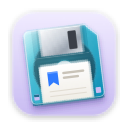

# stash

stash is a native SwiftUI app that archives X bookmarks, likes, and their media on the Mac. The installed app syncs every six hours.

## Planning

- [Plan](plan.md) — accepted decisions, open questions, and research findings.
- [SwiftUI rewrite](swiftui-rewrite.md) — implementation plan and visual references for the native app.
