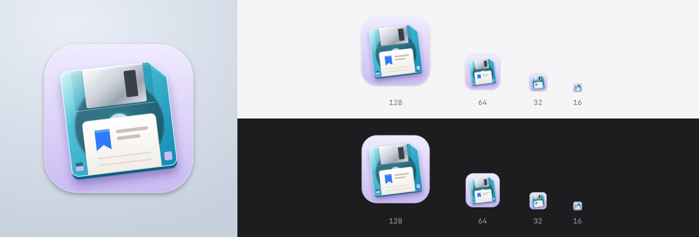
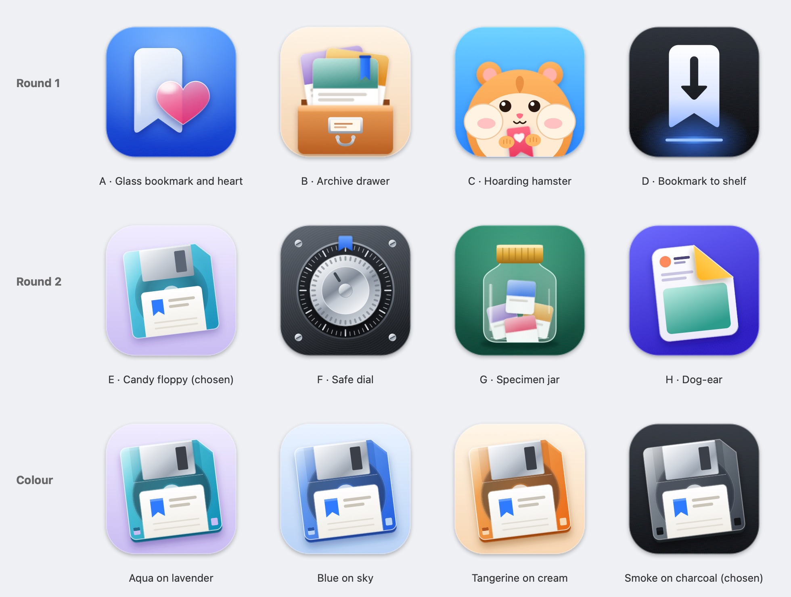

# Plan

## Accepted decisions

Decided by the user on 2026-11-17.

- **Scope:** track the user's own X saves, both bookmarks and likes.
- **Shell:** a simple web-rendered app in a Go native window, for now. Superseded on 2026-11-18 by the native SwiftUI rewrite in [Round 2](#round-2-answers).
- **Capture route:** scrape, not the official X API. The user signs in to their personal X account inside the app, then the app runs a scrape process over the bookmarks and likes pages. Reason: the user described the tool as "essentially a scraper" and asked to avoid the API, which is pay-per-use and needs a developer account.
- **Media:** the media attached to each save is stored locally.
- **Project conventions:** jstack wiki for records, plan for decisions, grill-form for interviews and confirmations.

### Round 1 answers

Submitted through grill-form on 2026-11-17.

- **Video:** downloaded at the highest quality X offers.
- **Scrape view:** hidden, with a progress count in the app. The x.com window appears only when a sign-in is needed.
- **Context:** the quoted post is kept; full threads are not.
- **First-version jobs:** local copy, indexed content with search, and boards. The user wants content indexed now so it is searchable, and boards in the style of Pinterest or Cosmos as an optional way to sort posts.
- **Sync:** periodically in the background, even when the window is closed.
- **Removed on X:** the local copy is kept with no marking, to stay lean.
- **Window:** webview_go. Superseded by Round 2.
- **Frontend:** plain HTML, CSS, and JavaScript with no build step. Superseded by Round 2.
- **Setup:** Go installed with Homebrew (1.27.4); `git init` run.

### Round 2 answers

Submitted through grill-form on 2026-11-18. The user asked to redesign the app with native SwiftUI instead of web UI components, and chose from four mock layouts. All three recommendations were accepted.

- **Layout: grid with inspector.** A `NavigationSplitView` with the sidebar holding Library (All Saves, Bookmarks, Likes, with counts) and Boards (with a + to add one). The content is a masonry grid of cards with media and text. Selecting a card opens an inspector on the right with the full post, an Open on X button, and board checkboxes. Reason: it keeps today's masonry browsing and Pinterest-style feel, and posts are filed into boards beside the grid without covering it. Not chosen: a Mail-style list and reader, a media-only gallery without a sidebar, and a single-column feed.
- **Sync placement: toolbar.** A Sync button in the toolbar; while a sync runs it shows progress and the new-post count in its place. The six-hour schedule toggle moves to a Settings window (⌘,). Reason: the usual Mac placement, and the status appears only while a sync runs or after an error. Not chosen: a sidebar footer, a menu bar item.
- **Engine: Swift throughout.** Sync, parsing, and storage are ported to Swift, giving one language and one app bundle. `inject.js` is reused as is, and the existing database and media stay in place. Reason: the Go side is about 1,000 lines, and the sync window's tricks (an invisible window that keeps rendering) become ordinary AppKit code instead of cgo. Accepted cost: one full sync must be re-checked on the user's account. Not chosen: keeping the Go sync engine as a helper inside the app, or SwiftUI over Go's local HTTP API.
- **Look:** standard macOS 27 SwiftUI with the system's glass sidebar and toolbar, following the system's light or dark appearance.
- **Implementation plan:** [SwiftUI rewrite](swiftui-rewrite.md), written 2026-11-18 for handoff to another agent.

### App icon

Chosen through grill-form on 2026-11-19 with jstack's `icon-design` skill. The app had no icon. References: App Icons Store, ktnr's Dribbble shots, and Icon Museum.

- **Round 1, all four rejected:** A, a glass bookmark and heart; B, an archive drawer; C, a hamster mascot; D, a dark bookmark with a download arrow. The user asked for four new directions without giving a reason.
- **Round 2, chosen: E, the candy floppy.** A translucent 3.5" floppy disk, the universal "save" icon, with a blue bookmark on its paper label. Not chosen: F, a chrome safe dial; G, posts in a specimen jar; H, a post with a dog-eared corner.
- **Refinement and color: smoke on charcoal.** The refined disk has visible thickness, the shutter channel, the write-protect and density holes, and the magnetic disk showing through the plastic. Not chosen: aqua on lavender (the round 2 color), blue on sky, and tangerine on cream.
- **Source:** `docs/design/app-icon/stash-icon.svg`, 1024 × 1024 on the macOS icon grid (an 824-point body with 185-point corners, plus the drop shadow). No X logo is used.
- **In the bundle:** `scripts/icon.sh` renders the SVG with WebKit at every size in an `.iconset` and packs `Resources/AppIcon.icns` with `iconutil`. `scripts/bundle.sh` copies it into the app, and `Info.plist` names it in `CFBundleIconFile`. The same script writes the PNG copies shown in the README (`docs/design/app-icon/stash-icon.png`, 512 px) and on the wiki home (`attachments/app-icon/icon-128.png`). Run `scripts/icon.sh` again after changing the SVG. Reason: there is no Xcode, so no Icon Composer or asset catalog, and the user chose not to install it. WebKit is used because NSImage's SVG renderer drops the shadows.

## Design

Choices made during implementation, under the decisions above.

- On 2026-11-18 the user revised Round 2: keep the left library sidebar and open post details in a gallery sheet. The grid uses the remaining width.
- Review answers, 2026-11-18, through grill-form and chat:
  - The post sheet resembles a post on X, for familiarity: avatar column, one-line byline, then text, media and quoted post.
  - Boards are a menu in the sheet header that can create a board with the post in it, because the old checkboxes were below the fold and absent with no boards.
  - The sheet keeps its 640 pt width and grows vertically with the window.
  - Done became a ✕ button, and clicking outside the sheet closes it.
  - The launchd agent is repointed only when its program is gone, so a dev build never takes over a working schedule.
  - Grid cards follow X too, at about today's compactness. The user chose from four prototypes in grill-form: avatar column, small avatar in the byline, media first, and a borderless timeline. They took the small avatar in the byline, quoted media as a 16:9 strip, X's photo mosaic, and X-style dates. Reason: familiarity without taller cards.
  - Details: [SwiftUI rewrite, Review revision](swiftui-rewrite.md#review-revision-2026-11-18).

- The Swift grid captures the posts and column indices together so a resizing inspector can finish rendering the previous layout. Approaching the scroll bottom also requests a page, because masonry columns can end at different heights.
- SwiftPM loads the CLT’s bundled Swift Testing macro explicitly for the test target. Incremental builds sometimes omitted it.
- Unbundled Swift sync exits before opening WebKit so a terminal run cannot inherit the Go window’s sign-in.

- **One sync path:** `stash sync` is its own process. The window's Sync button and the background schedule both run it, and a lock file allows one at a time.
- **Capture:** a script injected into x.com passes each Bookmarks and Likes timeline response to the Swift sync process, which parses and stores it. The process tells the page when to scroll or navigate. Scrolling is paced unevenly at 1.2 to 2.5 seconds. Media downloads alongside.
- **Invisible window:** the sync window is fully transparent and ignores the mouse rather than being hidden, because a hidden webview stops loading as it scrolls.
- **Sign-in:** detected from X's `twid` cookie or the sidebar profile link. A background sync never shows a window; it stops and asks for a manual Sync.
- **Stopping:** a timeline is marked complete when X returns an empty page. After that, a sync stops at the first page holding nothing new.
- **Background schedule:** a launchd agent, `com.stash.sync`, runs `stash sync` every six hours. It is off until switched on in the window or with `stash schedule on`.
- **Storage:** SQLite with full-text search, plus media files, under `~/Library/Application Support/stash`. Each post's original data from X is kept so it can be re-read later.

## Verification

Checked on 2026-11-17 against the uncommitted working tree, on the user's own account and machine.

| Check | Result |
| --- | --- |
| Parser unit test on a hand-written sample response | Passed |
| Full signed-in sync on live x.com | Passed: 807 bookmarks and 2,504 likes, each ending at X's final empty page |
| Media download | Passed for 3,102 of 3,103 files (17 GB); one video URL fails |
| Second sync with nothing new | Passed: exits cleanly in about 8 seconds |
| Background sync when signed out of X | Passed: stops in about 3 seconds with a sign-in message |
| Grid, detail view with quoted post, carousel, and video playback | Passed, driven in the real window through `XSAVES_EVAL` and screenshots |
| Search and filters on the full archive | Passed: about 10 ms per request |
| Boards | Passed on generated data only |
| Sign-in window flow | Passed once, by the user |
| Background schedule (launchd agent) | Untested |
| Review fixes (2026-11-18) | Build with no warnings, all six tests and the release bundle passed. Separate probe apps showed three things. Without an Edit menu, ⌘A in a WKWebView field left the selection at 0,0; with one, it selected 0–11. A ScrollView kept its offset when its content was replaced (7,208 → 2,472 pt); with `.id` it returned to 0. A local event monitor saw a click behind a SwiftUI sheet and closed it. On an archive copy, screenshots showed the X-style sheet for text, photos, video and quoted posts, the Boards menu, posters on videos, and empty-board copy. Opening the oldest save paged through all 2,822. Not clicked in the app: the Boards menu items, New Board…, closing by clicking outside, and video playback. |
| Swift M7 cutover (2026-11-18) | The user approved retiring Go on `swiftui`. After removal, the Swift build, all six tests, release bundle and signature check passed. The loaded six-hour agent points to the installed Swift app. |
| Swift M6 fresh media (2026-11-18) | One new bookmark and one new like in 19.1 seconds. Both media rows had `done = 1`. The bookmarked GIF (86,001 bytes) and liked video (70,994,565 bytes) were present on disk with both posters. Archive totals reached 2,822 distinct saves, 808 bookmarks and 2,507 likes. |
| Swift M6 gallery (2026-11-18) | On the copy, the new video advanced after Play with mute off. Its stereo AAC track had a measured peak of −13.4 dB in the first 12 seconds. Helium opened a test text link and the exact X status URL from the gallery. |
| Swift M6 signed-in sync (2026-11-18) | Both timelines returned 20 existing entries. Repeat sync finished in 6.9 seconds with exit 0. Concurrent sync exited 1. Settings removed and restored the launchd agent at the installed path. Both backups had 2,820 saves, 807 bookmarks and 2,506 likes. The sole pending media row predates these runs. |
| Swift gallery playback (2026-11-18) | A muted animated GIF advanced to its next loop item on the archive copy. The gallery exposed the selected post’s X URL. The subsequent fresh-media run checked video audio data and the browser destination. |
| Swift gallery and live checks (2026-11-18) | Opening a card, paging to item 2 of 4 and dismissing with Escape passed. The left sidebar remained present. Signed-out sync exited 1 in 3.86 seconds with matching JSON and stderr. The live launchd agent repointed to Swift on first launch. |
| Swift M5 (2026-11-18) | Six Swift tests passed, including launchd success and failure with a fake runner. A stub child displayed 4 new and 12 files left, then the expected error alert. Settings and startup UI overrides worked. Installed bundle passed codesign verification. |
| Swift M4 (2026-11-18) | Verified board creation, ticking three posts, filtering, unticking, confirming deletion and returning to 2,820 saves on the backup. Verified dark appearance, gallery buttons and right-arrow paging. A video started paused and unmuted and advanced after Play. A GIF advanced muted. Later playback checks are recorded above. |
| Swift M3 (2026-11-18) | Bundled window on backup showed 2,820 / 807 / 2,506. Typing swift returned 11 saves. Unmatched search displayed the system no-results view. An instrumented native scroll reached 2,820 unique saves and 2,506 unique likes. Peak sampled RSS was 775 MiB. |
| Swift M2 (2026-11-18) | SyncMachine tests passed. Holding the Go-compatible flock made the bundled command exit 1 with the expected stderr and JSON error. The subsequent attended signed-out check passed. |
| Swift M1 (2026-11-18) | Unit tests passed. Backup matched sqlite3 (2,820 distinct, 807 bookmarks, 2,506 likes). All Saves and Likes paged without gaps or duplicate IDs. |
| Swift M0 (2026-11-18) | Debug and release built, signature verified, bundle opened, and clicking the counter rendered 1. Invalid command printed usage and exited 1. |

`XSAVES_EVAL` holds a script to run in the window after it loads, and `XSAVES_DIR` points the app at another data folder. Both exist for checks like these.

## Fixed during the first real run

- **Redirects:** X sends `/i/bookmarks` to `/i/history` and `/<handle>/likes` to `/i/history/likes`. The sync now treats the timeline's own data arriving as proof of the right page, instead of comparing addresses.
- **Stalls:** scrolling stopped partway (at 260 and 600 bookmarks in two runs). The invisible window now floats above other windows on every space so the system does not pause it, and each scroll steps back before going to the bottom. The next run reached the end.
- **Media skipped after an error:** media now downloads while the page scrolls, whatever the outcome.
- **Crash on finish:** a late tick after the last phase indexed past the phase list.
- **Stray text in the UI:** `false`, `undefined`, and `null` rendered as text where a conditional element was absent.

## Open questions

- Is six hours the right background interval?
- Highest-quality video made the archive 17 GB. Keep that, or cap video size?
- ~~Should a card show the media of the post it quotes?~~ Answered on 2026-11-18: yes, as a strip capped at 16:9.
- When should the Go code be removed? Proposed: once the Swift app passes the checks in Verification. Nothing is committed to git yet, so the Go version has no other fallback.
- Will the Swift app need a fresh X sign-in? Likely, because its web storage is separate from the Go window's; unverified.
- ~~How should the icon get into the bundle?~~ Answered on 2026-11-19: as an `.icns` built from the SVG; see [App icon](#app-icon). On macOS 27, Finder shows it under the system's own mask, full size and not placed on a grey tile.
- Does the 16 px icon need its own simplified drawing? The floppy shape reads at that size, but its label and bookmark merge.

## Findings

Observed on 2026-11-18, for the SwiftUI rewrite:

- The machine runs macOS 27.0 in light appearance. Swift 6.4.2 is installed with the Command Line Tools; there is no Xcode, so `xcodebuild` is unavailable. A Swift tool using AppKit and WebKit compiled and ran with `swiftc`; a SwiftUI app built with SwiftPM has not been tried yet.
- The system SQLite is 3.54 and supports FTS5, which the store's `posts_fts` table uses.
- The Go code is about 1,000 lines plus `inject.js` (39 lines) and the web UI (about 370 lines).

Observed or researched on 2026-11-17. Third-party figures are unverified against X's own pricing page.

- The development machine has Node.js 24 and Fungi `v0.1.0-alpha.2`, but no Go toolchain on PATH and none installed through Homebrew.
- X's API has been pay-per-use since February 2026. Third-party guides quote about $0.001 per own bookmark or like returned, and about $0.005 per ordinary post read.
- The API bookmarks endpoint has historically returned only the most recent 800 bookmarks. The scrape route has no such documented limit.
- Signed out, x.com redirects `/i/bookmarks` to `/i/jf/onboarding/web`, not the older `/i/flow/login`.
- Signed in, the bookmarks and likes timelines both live under `/i/history`, and each ends with an empty page.
- Wails v2 is stable with a single window. Wails v3 adds multiple windows and was reported in beta in August 2026.

## Risks

- **Site changes:** the scrape reads the data x.com loads for its own pages. It can break whenever X changes that site.
- **Terms of service:** automated collection is against X's terms. Mitigation under consideration: the user's own account only, human-paced scrolling, and user-triggered runs.
