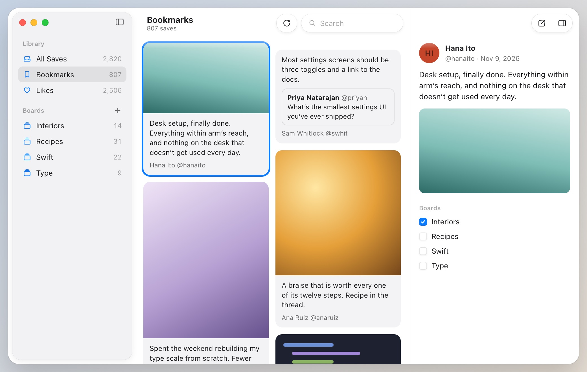
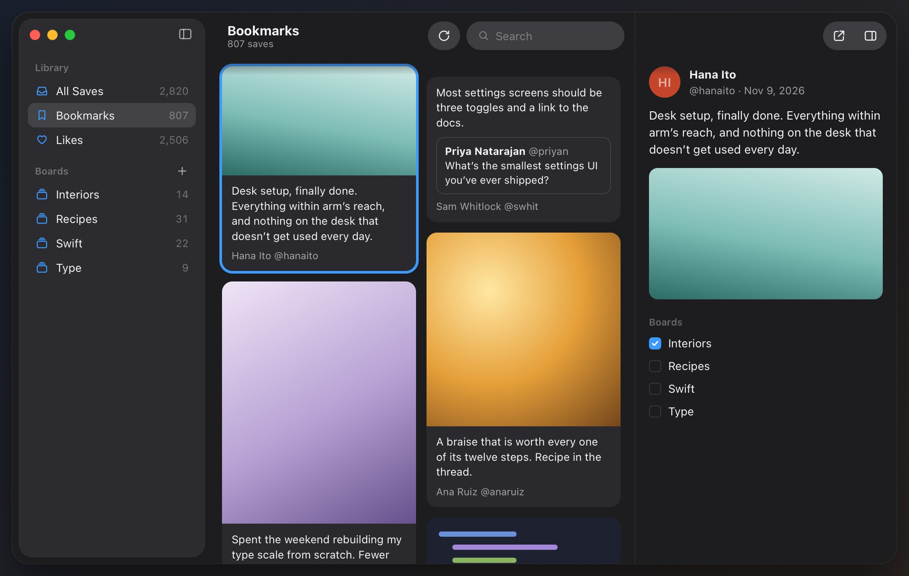
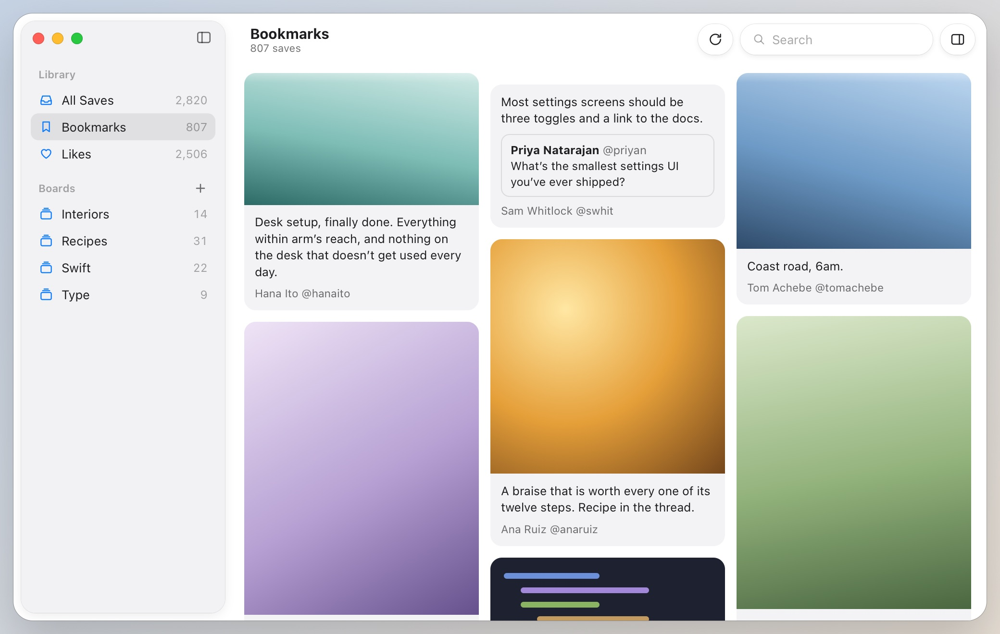
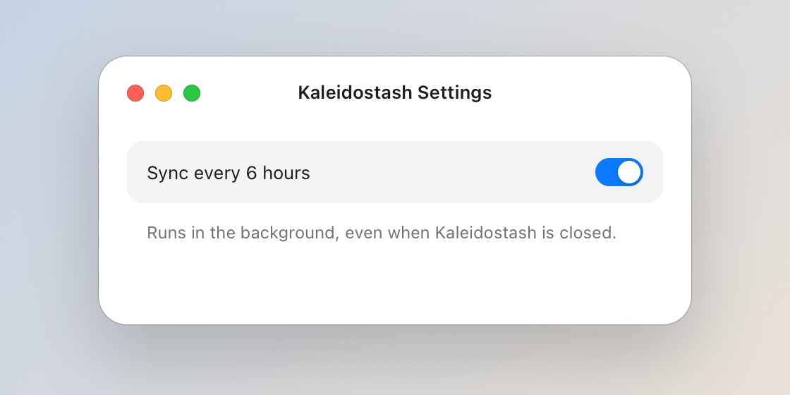
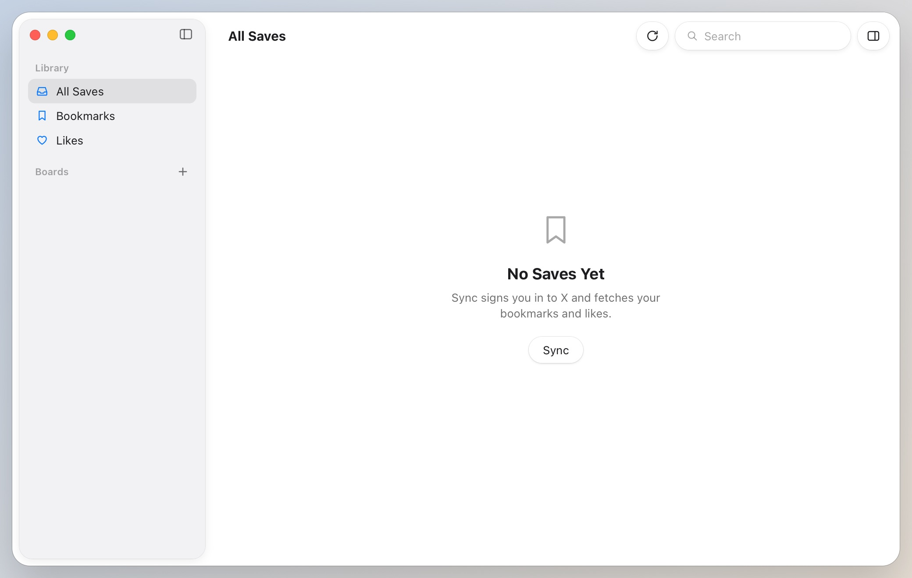
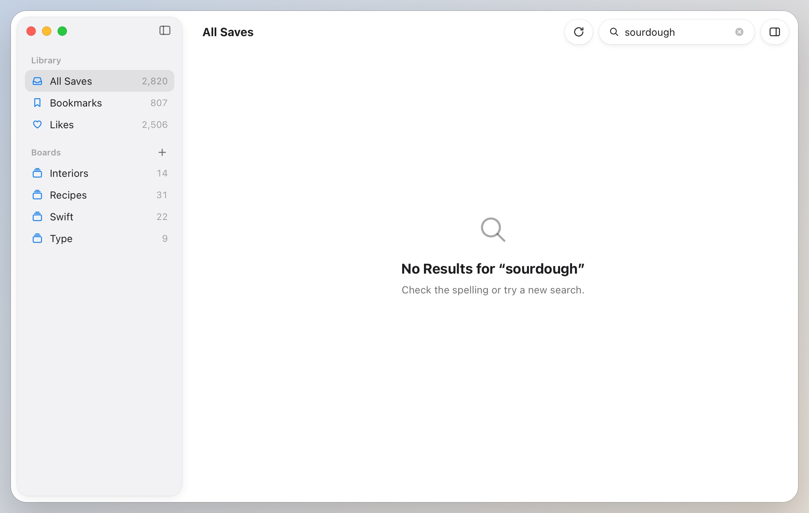
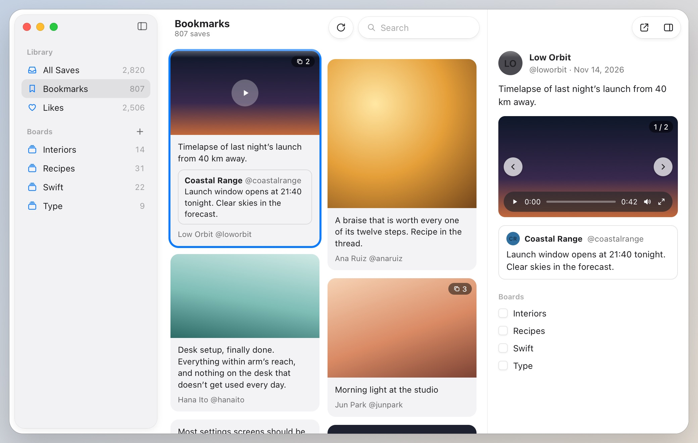
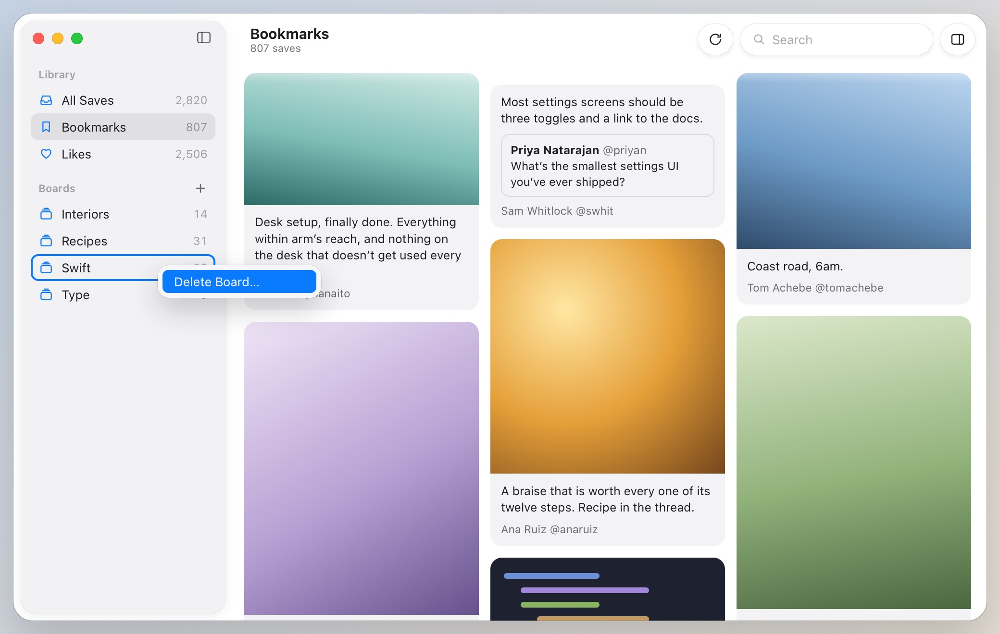

# SwiftUI rewrite

This is the implementation plan for rebuilding xsaves as a native macOS app in Swift and SwiftUI. It is written for the agent that will implement it, and it should be enough on its own. The decisions behind it are in [Plan, Round 2](plan.md#round-2-answers): grid with inspector, sync in the toolbar with the schedule in Settings, and Swift throughout.

The Go version is committed as `8064138` on `main` and works. It is the reference for behavior: when this plan doesn't say how something should behave, do what the Go code does.

## Rules for the implementer

1. **Toolchain:** build with SwiftPM and the Command Line Tools. Xcode is not installed, so don't use `xcodebuild`, `.xcodeproj` files or asset catalogs.
2. **No SwiftUI macros:** don't use `@State`, `@Entry` or `#Preview`. The macOS 27 SDK implements them as macros whose plugin ships only with Xcode, so they fail to build here. Use `@Observable` models, which work with the Command Line Tools, and the `@ViewState` wrapper given in [View-local state](#view-local-state).
3. **Link AVKit explicitly:** without it, SwiftUI's video player crashes at launch.
4. **Keep the data:** keep the existing database schema and data folder unchanged. The user's archive (24 MB database, 16 GB of media) must open as is, without migration.
5. **Never test against the real archive:** checks use a copy. See [Test data](#test-data).
6. **Leave x.com to the user:** the user must be present for anything that loads x.com, and you must never automate signing in. The scrape keeps its human pace.
   - Never run `xsaves sync` from `.build/` or through `swift run`. Outside a bundle, WebKit names its storage after the process, `xsaves`, which is the Go window's storage. That storage is signed in to X, so the "test" would scrape x.com for real. Run sync only from the bundled app (`build/xsaves.app/Contents/MacOS/xsaves sync` or the installed copy). Its storage belongs to `com.xsaves.app` and starts signed out.
7. **Keep the Go code:** don't delete it until the Swift app passes [Verification](#verification) and the user confirms. Until then both versions live side by side in the repo.
8. **Native look:** use system components (`NavigationSplitView`, `.inspector`, `.searchable`, toolbar items, `Form`, `ContentUnavailableView`) and let macOS 27 draw the glass. Never paint glass or window chrome yourself. The mocks show structure, content, hierarchy and sizes; when the system draws something differently from a mock, the system wins.
9. **Plain UI:** every label and element needs a reason to exist (jstack `rule-plain-ui`). Don't add anything this plan doesn't call for.
10. **Lean code:** choose the simplest complete solution and add no dependencies beyond Apple's SDK (jstack `rule-lean`).
11. **Git:** work on a branch named `swiftui` and commit at the end of each milestone.
12. **Records:** record outcomes in this wiki. See [Records](#records).

## Facts checked on 2026-11-18

All of these were checked on the user's Mac with throwaway probes outside the repo.

| Fact | How it was checked |
|---|---|
| macOS 27.0 (26A5368g) on a MacBookPro18,1, in light appearance | `sw_vers`, system settings |
| Swift 6.4.2 with the Command Line Tools and the macOS 27.2 SDK; no Xcode | `swift --version`, `xcode-select -p` |
| A SwiftPM package with `swift-tools-version: 6.2` and `platforms: [.macOS(.v26)]` builds a SwiftUI app that uses `NavigationSplitView`, `.inspector`, `.searchable`, `ContentUnavailableView`, a `Settings` scene, `@Observable`, `@Bindable`, `@FocusState`, `@Environment` and `WKWebView` | Built a probe package |
| `@State` fails with: `external macro implementation type 'SwiftUIMacros.StateMacro' could not be found for macro 'State()'; plugin for module 'SwiftUIMacros' not found` | Same probe. The SDK's `SwiftUICore` declares `macro State()`, `macro Entry()`, `macro Animatable()`; `SwiftUI` declares `macro Previewable()` |
| The `@ViewState` wrapper below compiles | Built in the probe; behavior at run time is not yet checked |
| With AVKit only imported, a window showing `VideoPlayer` crashes at launch with `failed to demangle superclass of VideoPlayerView from mangled name 'So12AVPlayerViewC'`. With `linkedFramework("AVKit")` it runs | Ran the probe both ways |
| `swift test` runs Swift Testing (`import Testing`) tests | Probe test target |
| A `.app` folder with an `Info.plist` and an ad hoc signature (`codesign --force --sign -`) passes `codesign --verify` and launches with `open` | Probe bundle. That launch hit the AVKit crash above; the fixed build was run directly, not re-bundled |
| `import SQLite3` links the system SQLite 3.54.0. It opened a backup copy of the real database in WAL mode, and FTS5 `MATCH` and the Go list query both ran | Probe against a `.backup` copy |
| `WKPreferences.inactiveSchedulingPolicy`, `WKScriptMessageHandlerWithReply`, `SidebarCommands` and `InspectorCommands` are in the SDK | SDK headers and interfaces |

The archive as of 2026-11-18:

| Item | Value |
|---|---|
| Posts stored, including quoted posts | 3,198 |
| Saved posts (distinct) | 2,820 |
| Bookmarks / likes | 807 / 2,506 |
| Media: photos / videos / animated GIFs | 2,080 / 949 / 75 (one video never downloads) |
| Posts that quote another post | 427 |
| Boards | none yet |
| `meta` rows | `complete:bookmark = 1`, `complete:like = 1` |
| Data folder | `~/Library/Application Support/xsaves`: `xsaves.db` (+ `-wal`, `-shm`), `media/`, `sync.lock`, `sync.log` |
| launchd agent | `~/Library/LaunchAgents/com.xsaves.sync.plist` is installed and points to the Go binary `/Users/rengwu/Projects/xsaves/xsaves`. `launchctl print` shows `runs = 0` |
| Go window's web storage (the X sign-in) | `~/Library/WebKit/xsaves`, `~/Library/HTTPStorages/xsaves.binarycookies`, `~/Library/Caches/xsaves`. These are named after the process, so the new app, with its own bundle identifier, starts signed out. The user signs in once |

## What gets replaced

| Go file | Job | Swift destination |
|---|---|---|
| `main.go` | Subcommands, window setup, launchd schedule | `Sources/XSaves/Entry.swift`, `Sources/XSavesCore/Schedule.swift` |
| `store.go` | Schema, inserts, queries, media paths | `Sources/XSavesCore/Database.swift`, `Store.swift`, `Paths.swift` |
| `parse.go`, `parse_test.go` | Timeline JSON → posts and saves | `Sources/XSavesCore/Parse.swift`, `Tests/XSavesCoreTests/ParseTests.swift` |
| `sync.go` | Invisible x.com window, scrape steps, media downloads, progress lines | `Sources/XSaves/Sync/*`, `Sources/XSavesCore/Downloader.swift`, `SyncMachine.swift`, `Progress.swift` |
| `window.go` | Making the window invisible or visible through cgo | Plain AppKit in `Sources/XSaves/Sync/SyncWindow.swift` |
| `inject.js` | Captures timeline responses, scrolls, navigates | `Sources/XSaves/Sync/InjectScript.swift`, the same script with a two-line bridge change |
| `server.go`, `ui/*` | Local HTTP API and web UI | `Sources/XSaves/UI/*` (no server) |

## Architecture

```text
xsaves.app/Contents/MacOS/xsaves          one executable, three modes
│
├─ (no arguments)       SwiftUI app: window + Settings
│     └─ starts a child process "xsaves sync --login" and reads its progress lines
├─ sync [--login]       AppKit: invisible WKWebView on x.com, stores pages, downloads media
│     ▲  launchd runs "xsaves sync" every 6 hours (com.xsaves.sync)
└─ schedule on|off      installs or removes the launchd agent
```

- There's still one sync path. The window's Sync button and launchd both run `xsaves sync` as its own process, and `sync.lock` lets only one run at a time. The lock is the same file the Go version uses, so while both exist they also exclude each other.
- The database is opened separately by the app and by a sync process. WAL mode and a 10-second busy timeout make that safe, as in Go.
- The sync child is a second instance of the same bundle, so it shares the bundle's WebKit storage and stays signed in. launchd runs the executable inside the bundle, so it shares that storage too.

### Package layout

```text
Package.swift
Resources/Info.plist
scripts/bundle.sh
Sources/
  XSavesCore/                 no UI; everything here has unit tests
    Paths.swift               data folder, media file names, avatar URL rule
    Database.swift            small SQLite3 wrapper
    Store.swift               actor: schema, inserts, queries, boards, counts
    Models.swift              Media, Post, Save, PostContent, PostView, MediaView, Board, Counts, PostQuery
    Parse.swift               timeline JSON → [Post], [Save]
    SyncMachine.swift         sync decisions as a pure state machine, with no I/O
    Progress.swift            the progress line format
    Downloader.swift          media and avatar downloads
    Schedule.swift            launchd agent install, remove, status
  XSaves/
    Entry.swift               @main: dispatches the modes
    Sync/SyncCommand.swift    runs a sync: lock, NSApplication, window, web view, downloads, exit code
    Sync/SyncWindow.swift     invisible and visible window states
    Sync/InjectScript.swift   the injected JavaScript as a string
    UI/XSavesApp.swift        App, scenes, commands, app delegate
    UI/AppModel.swift         @Observable state and actions for the window
    UI/SyncController.swift   runs the child sync process and reads its progress
    UI/ContentView.swift      NavigationSplitView, toolbar, alerts, empty states
    UI/SidebarView.swift
    UI/GridView.swift         masonry columns, paging
    UI/CardView.swift
    UI/InspectorView.swift
    UI/MediaViews.swift       thumbnails, gallery, player
    UI/ImageLoader.swift      downsampled image cache
    UI/SettingsView.swift
    UI/ViewState.swift
    UI/DebugHooks.swift       XSAVES_UI and XSAVES_SNAPSHOT
Tests/
  XSavesCoreTests/
    ParseTests.swift  StoreTests.swift  PathsTests.swift  SyncMachineTests.swift  ProgressTests.swift
```

### Package.swift

```swift
// swift-tools-version: 6.2
import PackageDescription

let package = Package(
    name: "xsaves",
    platforms: [.macOS(.v26)],
    targets: [
        .target(
            name: "XSavesCore",
            linkerSettings: [.linkedLibrary("sqlite3")]
        ),
        .executableTarget(
            name: "xsaves",
            dependencies: ["XSavesCore"],
            path: "Sources/XSaves",
            linkerSettings: [.linkedFramework("AVKit"), .linkedFramework("WebKit")]
        ),
        .testTarget(name: "XSavesCoreTests", dependencies: ["XSavesCore"]),
    ]
)
```

Swift 6 language mode with strict concurrency, which is the default for these tools.

### Entry point

```swift
@main
enum Entry {
    static func main() {
        // Finder and `open` can pass arguments that start with "-"; they are not subcommands.
        let args = CommandLine.arguments.dropFirst().filter { !$0.hasPrefix("-") || $0 == "--login" }
        switch args.first {
        case nil:        XSavesApp.main()
        case "sync":     SyncCommand.run(login: args.dropFirst().first == "--login")   // never returns; exits 0 or 1
        case "schedule": /* "on" or "off" → Schedule.set(on:); print the error and exit 1 on failure */
        default:         /* print "usage: xsaves [sync [--login] | schedule on|off]" to stderr; exit 1 */
        }
    }
}
```

`XSavesApp` is a plain `struct XSavesApp: App` without `@main`.

### Concurrency

- `Store` is an `actor` that owns one SQLite connection. Other code never sees the connection.
- Models are `Sendable` value types.
- `AppModel` is `@MainActor @Observable`.
- `SyncCommand` and its WebKit delegates run on the main actor. Parsing and storing happen off the main actor, in one consumer task that processes captures in order (see [Sync](#sync-command)).
- Images are decoded off the main actor in `ImageLoader`.

### Environment variables

| Variable | Meaning |
|---|---|
| `XSAVES_DIR` | Data folder, replacing `~/Library/Application Support/xsaves`. Same as Go. Passed through to the sync child |
| `XSAVES_UI` | Verification only. JSON that sets the window's starting state. See [Debug hooks](#debug-hooks) |
| `XSAVES_SNAPSHOT` | Verification only. A PNG path. See [Debug hooks](#debug-hooks) |

## Core module

### Paths

- `dataDir`: `XSAVES_DIR` if set, otherwise `FileManager.default.url(for: .applicationSupportDirectory, in: .userDomainMask, ...)/xsaves`. Create `media/` on open.
- `mediaFile(postID, media)` returns a path relative to `media/`:
  - photo: `"<postID>/<mediaID>.<ext>"`, where `ext` is the value of `format=` in the URL (up to the next `&`), or `jpg` if there's none;
  - video and animated_gif: `"<postID>/<mediaID>.mp4"`.
- `posterFile(postID, media)` returns `"<postID>/<mediaID>.poster.jpg"`.
- `avatarFile(authorID)` returns `"avatars/<authorID>.jpg"`. The avatar download URL is the stored URL with its first `_normal.` replaced by `_400x400.`.

These must match Go exactly. 3,103 downloaded files already use these names.

### Database wrapper

This is a thin layer over the `SQLite3` C API, not an ORM.

- `open(path)`: `sqlite3_open_v2` with `SQLITE_OPEN_READWRITE | SQLITE_OPEN_CREATE`, then `PRAGMA journal_mode=WAL` and `PRAGMA busy_timeout=10000`.
- `execute(sql)` for statements without parameters, using `sqlite3_exec`.
- `run(sql, bindings...) -> (changes: Int, lastRowID: Int64)`.
- `query(sql, bindings...) { row in ... }`, with column getters for `String`, `Int64`, `Int` and `Bool`. A NULL text column reads as `""`.
- `transaction { ... }`: `BEGIN` / `COMMIT`, with `ROLLBACK` on a thrown error.
- Bind text with `SQLITE_TRANSIENT` (`unsafeBitCast(-1, to: sqlite3_destructor_type.self)`). Every failure throws an error carrying `sqlite3_errmsg`.

### Store

`actor Store`, created with `Store(dataDir:)`. Run this schema verbatim on open:

```sql
CREATE TABLE IF NOT EXISTS posts(
	id TEXT PRIMARY KEY, author_id TEXT, name TEXT, handle TEXT, avatar TEXT,
	text TEXT, created_at TEXT, quoted_id TEXT, raw TEXT);
CREATE TABLE IF NOT EXISTS saves(
	post_id TEXT, kind TEXT, sort INTEGER, PRIMARY KEY(post_id, kind));
CREATE TABLE IF NOT EXISTS media(
	id TEXT PRIMARY KEY, post_id TEXT, type TEXT, url TEXT, poster TEXT,
	w INTEGER, h INTEGER, done INTEGER NOT NULL DEFAULT 0);
CREATE INDEX IF NOT EXISTS media_post ON media(post_id);
CREATE TABLE IF NOT EXISTS boards(id INTEGER PRIMARY KEY, name TEXT UNIQUE);
CREATE TABLE IF NOT EXISTS board_posts(
	board_id INTEGER, post_id TEXT, PRIMARY KEY(board_id, post_id));
CREATE TABLE IF NOT EXISTS meta(k TEXT PRIMARY KEY, v TEXT);
CREATE VIRTUAL TABLE IF NOT EXISTS posts_fts USING fts5(text, name, handle);
```

`kind` is the string `bookmark` or `like`. Model it as `enum Kind: String { case bookmark, like }`.

| Function | Behavior (port of the Go function in brackets) |
|---|---|
| `addPage(kind, posts, saves) -> Int` | One transaction [`addPage`]. For each post: `INSERT OR IGNORE INTO posts VALUES(?,?,?,?,?,?,?,?,?)`. Only if a row was inserted, also insert `posts_fts(rowid, text, name, handle)` using the new rowid, and `INSERT OR IGNORE INTO media(id, post_id, type, url, poster, w, h)` for each media item. For each save: `INSERT OR IGNORE INTO saves VALUES(?,?,?)`. Returns how many save rows were inserted. |
| `meta(_:) -> String`, `setMeta(_:_:)` | `SELECT v FROM meta WHERE k=?` (`""` if missing); `INSERT ... ON CONFLICT(k) DO UPDATE SET v=excluded.v` |
| `posts(_ query: PostQuery, offset: Int, limit: Int = 60) -> [PostView]` | [`listPosts`, `loadPost`] SQL below. Each post's media is in `rowid` order. Load the quoted post (one level) when `quoted_id != ''`. |
| `count(_ query: PostQuery) -> Int` | Same `WHERE` clause, `SELECT count(DISTINCT p.id) ...`. Used for the subtitle. |
| `counts() -> Counts` | `count(DISTINCT post_id)` from `saves`; `count(*)` per kind. |
| `boards() -> [Board]` | `SELECT b.id, b.name, count(bp.post_id) FROM boards b LEFT JOIN board_posts bp ON bp.board_id = b.id GROUP BY b.id ORDER BY b.name COLLATE NOCASE` |
| `createBoard(name) -> Board.ID` | Trim whitespace and reject an empty name. `INSERT OR IGNORE INTO boards(name) VALUES(?)`, then `SELECT id FROM boards WHERE name = ?`. An existing name returns the existing board. |
| `deleteBoard(id)` | In one transaction: delete its `board_posts` rows, then the board. |
| `setPost(_ postID, inBoard boardID, _ on: Bool)` | `INSERT OR IGNORE INTO board_posts VALUES(?, ?)` or `DELETE FROM board_posts WHERE board_id = ? AND post_id = ?` |
| `pendingMedia() -> [(postID, Media)]` | `SELECT id, post_id, type, url, poster FROM media WHERE done = 0 AND url != ''` |
| `avatars() -> [(authorID, url)]` | `SELECT DISTINCT author_id, avatar FROM posts WHERE avatar != ''` |
| `markDone(mediaID)` | `UPDATE media SET done = 1 WHERE id = ?` |

List query, where `PostQuery` is `{ kind: Kind?, board: Board.ID?, text: String }`:

```sql
SELECT p.id, p.quoted_id
FROM saves s JOIN posts p ON p.id = s.post_id
WHERE 1
  [AND s.kind = ?]                                                                  -- kind
  [AND p.id IN (SELECT post_id FROM board_posts WHERE board_id = ?)]                -- board
  [AND p.rowid IN (SELECT rowid FROM posts_fts WHERE posts_fts MATCH ?)]           -- text, via ftsQuery
GROUP BY p.id ORDER BY max(s.sort) DESC LIMIT ? OFFSET ?
```

`ftsQuery(text)` splits on whitespace, doubles each `"` inside a word, wraps each word as `"word"*`, and joins them with spaces. An empty result means no text filter. This keeps punctuation from being read as search syntax.

Loading one post:
- Content: `SELECT author_id, name, handle, text, created_at FROM posts WHERE id=?`.
- Media: `SELECT id, type, url, w, h, done FROM media WHERE post_id=? ORDER BY rowid`. When `done = 1`, `file` is `mediaFile`, and for anything other than a photo `poster` is `posterFile`. Both are absolute `URL`s under `media/`.
- Boards: `SELECT board_id FROM board_posts WHERE post_id=?`.

Models:

```swift
struct MediaView: Sendable, Hashable { let id: String; let type: MediaType; let width: Int; let height: Int; let file: URL?; let poster: URL? }
enum MediaType: String, Sendable { case photo, video, animatedGIF = "animated_gif" }
struct PostContent: Sendable, Hashable { let id: String; let authorID: String; let name: String; let handle: String; let text: String; let createdAt: Date?; let media: [MediaView] }
struct PostView: Sendable, Hashable, Identifiable { var id: String { content.id }; let content: PostContent; var boards: Set<Int64>; let quoted: PostContent? }
struct Board: Sendable, Hashable, Identifiable { let id: Int64; let name: String; let count: Int }
struct Counts: Sendable, Equatable { let all: Int; let bookmarks: Int; let likes: Int }
```

`createdAt` is stored as an RFC 3339 UTC string, or `""` when parsing failed. Read it with `Date.ISO8601FormatStyle`; `""` becomes `nil`.

### Parser

`Parse.parse(_ body: Data) throws -> (posts: [Post], saves: [Save])` is a port of `parse.go`. Read the JSON with `JSONSerialization` into `Any` and walk it the way Go does:

- **Walk:** an array is walked element by element. In a dictionary whose `entryId` starts with `tweet-`, parse `content.itemContent.tweet_results.result` and stop descending. If that returns an ID, append `Save(postID: id, sort: Int64(sortIndex) ?? 0)` (`sortIndex` is a string). Any other dictionary is walked through all of its values.
- **parsePost(result):**
  - If `result.tweet` exists (TweetWithVisibilityResults), use it instead.
  - Return `nil` when `rest_id` or `legacy` is missing (tombstones).
  - User is `core.user_results.result`:
    - `authorID = user.rest_id`;
    - `name` = `user.core.name`, else `user.legacy.name`;
    - `handle` = `user.core.screen_name`, else `user.legacy.screen_name`;
    - `avatar` = `user.avatar.image_url`, else `user.legacy.profile_image_url_https`.
  - Text is `legacy.full_text`, with `urls = legacy.entities.urls`. If `note_tweet.note_tweet_results.result.text` is non-empty, use that text and its `entity_set.urls` instead.
  - For each URL entity that has both `url` and `expanded_url`, replace the short URL with the expanded one.
  - For each `legacy.extended_entities.media` item, remove its `url` from the text (skip the replacement when `url` is empty) and append `parseMedia(item)`.
  - Unescape HTML entities: `&amp;`, `&lt;`, `&gt;`, `&quot;`, `&#39;`, `&apos;`, and numeric `&#N;` / `&#xH;`, with `&amp;` handled last. Then trim whitespace and newlines.
  - `createdAt`: parse `legacy.created_at` with format `EEE MMM dd HH:mm:ss Z yyyy` in locale `en_US_POSIX` and write it as `yyyy-MM-dd'T'HH:mm:ss'Z'` in UTC. Write `""` when parsing fails.
  - `quotedID` = parsePost(`quoted_status_result.result`), recursively. The quoted post is appended first.
  - `raw` is the post's dictionary with `quoted_status_result` removed, serialized with `JSONSerialization` (`.sortedKeys`).
  - Append the post and return its ID.
- **parseMedia(item):**
  - `id = id_str`, `type`, `w` / `h` = `original_info.width` / `original_info.height`.
  - For a photo, the URL is `media_url_https` with its extension replaced by `?format=<ext>&name=orig`. For example, `.../AAA.jpg` becomes `.../AAA?format=jpg&name=orig`.
  - Otherwise, `poster = media_url_https` and the URL is the `video_info.variants` entry with `content_type == "video/mp4"` and the highest `bitrate`, or `""` if there is none.

`ParseTests` copies the `sample` JSON from `parse_test.go` verbatim and makes the same assertions:
- one save `("100", 1900000000000000100)`;
- two posts, with the quoted post first: ID `50`, text `the long version`, handle `bo`, a non-empty avatar;
- the post's text is `Tom & Jerry https://example.com/a`, its quoted ID is `50`, handle `ada`, `createdAt` `2018-10-10T20:19:24Z`;
- the photo URL is `https://pbs.twimg.com/media/AAA?format=jpg&name=orig`;
- the video URL is `https://video.twimg.com/high.mp4` with a non-empty poster.

### Progress

```swift
struct Progress: Codable, Sendable, Equatable {
    var bookmarks = 0      // new saves found this run
    var likes = 0
    var media = 0          // files still to download
    var error: String?     // omitted from JSON when nil
}
```

The sync process writes the whole struct as one JSON line on stdout each time it changes, for example `{"bookmarks":3,"likes":0,"media":12}`. Write with `FileHandle.standardOutput.write(_:)`, not `print`: stdout is a pipe and `print` buffers it, which would stall the app's progress. Lines that aren't JSON must be ignored by readers.

### Downloader

`actor Downloader` ports `downloadMedia`. It holds the store and the run's `failed` set, and offers `runOnce(progress: @Sendable (Int) async -> Void)`.

1. Build the job list:
   - for each pending media row, a poster job first (when `poster != ""`), then the main file job, which carries `mediaID`;
   - then avatar jobs for every author.
2. Skip any job whose file is in `failed`. Skip poster and avatar jobs whose file already exists. Main media jobs always run, because `done = 0` means the file is incomplete.
3. Report `left = jobs.count`, then run at most 4 downloads at a time with a `TaskGroup`. After each job, decrement `left` and report it.
4. A download uses `URLSession` with a 600-second resource timeout. It writes to a temporary file, moves it into place (creating folders), and fails on any status other than 200.
5. On failure, add the file to `failed`; the next pass of the same run skips it. On success of a main file, call `markDone`.

### Schedule

Port of `setSchedule` in `main.go`. The label stays `com.xsaves.sync` and the plist goes in `~/Library/LaunchAgents/com.xsaves.sync.plist`.

- `isOn`: the plist exists.
- `set(on:)`:
  1. Run `launchctl bootout gui/<uid>/com.xsaves.sync`, ignoring failure.
  2. If turning off, delete the plist and stop.
  3. If turning on, write the plist (below) with `ProgramArguments = [<this executable's path>, "sync"]`, `StartInterval = 21600`, and `StandardOutPath` and `StandardErrorPath` both `<dataDir>/sync.log`.
  4. Run `launchctl bootstrap gui/<uid> <plist>`. If it fails, delete the plist and throw `launchctl: <trimmed output>`.
- `programPath`: reads `ProgramArguments[0]` from the plist, so the app can repoint the agent (see [App startup](#app-startup)).

```xml
<?xml version="1.0" encoding="UTF-8"?>
<!DOCTYPE plist PUBLIC "-//Apple//DTD PLIST 1.0//EN" "http://www.apple.com/DTDs/PropertyList-1.0.dtd">
<plist version="1.0"><dict>
	<key>Label</key><string>com.xsaves.sync</string>
	<key>ProgramArguments</key><array><string>EXECUTABLE</string><string>sync</string></array>
	<key>StartInterval</key><integer>21600</integer>
	<key>StandardOutPath</key><string>LOG</string>
	<key>StandardErrorPath</key><string>LOG</string>
</dict></plist>
```

Write it with `PropertyListSerialization` instead of string formatting, so paths with special characters stay valid.

## Sync command

`SyncCommand.run(login:)` ports `runSync`, `capture`, `tick` and `window.go`.

### Lifecycle

1. Open `<dataDir>/sync.lock` and take `flock(fd, LOCK_EX | LOCK_NB)`. If the lock is taken, report the error `A sync is already running.` and exit 1.
2. Open a `Store`. Set up `NSApplication.shared` with activation policy `.accessory`.
3. Create the window and web view (below), make the window invisible, and load `https://x.com/i/bookmarks`.
4. Start the media loop: `runOnce`, then a 3-second sleep, repeated until the scrape finishes. Each pass updates `Progress.media`.
5. Call `NSApp.run()`.
6. When the state machine finishes or fails:
   - stop the scrape;
   - cancel the media loop;
   - run one final media pass;
   - close the window;
   - exit 0, or exit 1 after writing the error to stderr. The progress line already carries the error.
7. If the user closes the visible sign-in window, report `Sync cancelled: the sign-in window was closed.` and exit 1.
8. Keep App Nap from throttling the process for the whole run: `ProcessInfo.processInfo.beginActivity(options: [.userInitiated, .idleSystemSleepDisabled], reason: "Syncing X saves")`.

### Window and web view

- `NSWindow` of 1280×900 points, so x.com shows its sidebar, which names the account. Style is titled, closable, miniaturizable and resizable; title `Sign in to X`; `isReleasedWhenClosed = false`.
- `WKWebViewConfiguration`:
  - `websiteDataStore = .default()`;
  - `preferences.inactiveSchedulingPolicy = .none`, so WebKit doesn't throttle a web view it considers hidden;
  - one `WKUserScript(source: InjectScript.source, injectionTime: .atDocumentStart, forMainFrameOnly: true, in: .page)`;
  - message handler `xsCapture` (`WKScriptMessageHandler`) and reply handler `xsTick` (`WKScriptMessageHandlerWithReply`), both in `.page`.
- **Invisible** (port of `windowInvisible`):
  - `NSApp.setActivationPolicy(.accessory)`;
  - `alphaValue = 0`, `ignoresMouseEvents = true`, `level = .floating`;
  - `collectionBehavior = [.canJoinAllSpaces, .stationary, .fullScreenAuxiliary]`;
  - `orderFrontRegardless()`.

  Never hide or miniaturize the window instead: a hidden web view stops loading as it scrolls. The Go version learned this through stalls at 260 and 600 bookmarks.
- **Visible** (port of `windowVisible`):
  - `NSApp.setActivationPolicy(.regular)`;
  - `alphaValue = 1`, `ignoresMouseEvents = false`, `level = .normal`;
  - `collectionBehavior = []`;
  - `center()`, `makeKeyAndOrderFront(nil)`, `NSApp.activate()`.

### Injected script

`InjectScript.source` is `inject.js` from commit `8064138`, character for character. The only change is two lines inserted after its first `if (...) return;` guard, which replace the global functions webview_go used to provide:

```js
  const xsCapture = (op, status, body) => window.webkit.messageHandlers.xsCapture.postMessage({op, status, body});
  const xsTick = (path, handle, signedIn) => window.webkit.messageHandlers.xsTick.postMessage({path, handle, signedIn});
```

Because they are local to the script's closure, x.com's own code never sees them. `xsTick` resolves to the reply object, so `await xsTick(...)` works unchanged. The reply is `{}`, `{"go": "<url>"}` or `{"scroll": true}`. The script keeps owning the pacing:
- first tick 1.5 s after load, then every 1.2 to 2.5 s at random;
- each scroll steps back 800 px, then 250 ms later jumps to the bottom.

### Captures

The `xsCapture` handler receives `{op: "Bookmarks"|"Likes", status, body}` and yields it to an `AsyncStream`. A single consumer task handles captures in order, off the main actor:

1. If `status != 200`, fail with `X refused the request (status <status>). Try again later.`
2. Parse the body and call `store.addPage(kind, posts, saves)`. A parse or store error fails with its message.
3. Log `<kind> page: <saves.count> saves, <added> new` to stderr, and add `added` to `Progress.bookmarks` or `Progress.likes`.
4. Tell the state machine on the main actor: `captured(kind:, saveCount:, added:, alreadyComplete: store.meta("complete:<kind>") == "1", now:)`. If it says the timeline is now complete, call `store.setMeta("complete:<kind>", "1")`.

### State machine

`SyncMachine` is a value type with no I/O, so it can be fully unit-tested with a fake clock. Its state, ported from the `syncer` struct, is:

- `login`;
- `phase` (0 = bookmarks, 1 = likes, 2 = done);
- `handle`, `stop`, `started`, `opened` (initially `true`, because the first URL is loaded directly), `gotData`, `lastData`, `path`, `shown`.

`tick(now:, path:, handle:, signedIn:) -> Effects` follows `tick` in `sync.go` step by step:

1. If `phase == done`, return nothing.
2. Remember a non-empty `handle`. When `path` changes, log `x.com is showing <path>`.
3. If not signed in, set `started = now`.
   - Without `login`: fail with `Sign in to X: press Sync in the xsaves window.`
   - With `login` and the window not yet shown: set `shown`, show the window, and return `go https://x.com/i/flow/login`.
   - Otherwise return nothing.
4. If `shown` (now signed in): clear `shown` and `opened`, and make the window invisible again.
5. Until this phase's data has arrived (`!gotData`), with `want` = `/i/bookmarks` for phase 0 or `/<handle>/likes` for phase 1:
   - after 45 s since `started`, fail with `X did not load your <kind>s. It showed <path>.`;
   - else, in phase 1 with no handle yet, wait;
   - else, if not `opened`, set `opened` and return `go https://x.com<want>`.
   - Return nothing.
6. If `stop`, or 30 s have passed since `lastData`:
   - log `<kind>s stopped loading before the end` if `stop` isn't set;
   - move to the next phase, resetting `stop`, `gotData` and `opened`, and setting `started = now`;
   - if all phases are done, finish.
   - Return nothing.
7. Otherwise return `scroll`.

`captured(...)` follows the end of `capture`:

1. Ignore the capture if `phase == done` or the kind isn't the current phase's.
2. Set `gotData = true` and `lastData = now`.
3. If the page held no saves, report that the timeline is now complete and set `stop`. X ends a timeline with an empty page.
4. Otherwise, if `added == 0` and the timeline is already complete, set `stop`: everything older is already stored.

`SyncMachineTests` cover:
- signed out without `login`;
- signed out with `login`: shows the window and navigates to sign-in once, then hides it after sign-in;
- the 45-second message;
- the likes phase waiting for the handle and then going to `/<handle>/likes`;
- the empty page marking the timeline complete;
- stopping at the first page with nothing new on a complete timeline;
- the 30-second stall moving on;
- finishing after the likes phase.

## App

### Visual references

These screens show the chosen design at 1040×660 points. The posts, names and board names are made up. Gradients stand in for photos, the dark tile with colored bars stands in for a screenshot, and the colored circles with initials stand in for avatar images. Sidebar counts are the real archive's. Each screen has an HTML source in `docs/design/swiftui-prototypes/`, which opens in a browser and follows its light or dark setting.

**Main window: a post selected, inspector open**



**The same in dark appearance**



**Inspector hidden: the grid gains a column, and the inspector button moves to the end of the toolbar**



**Sync running: the Sync button becomes a spinner with the new-post count**


**Settings window**



**First run with no saves**



**Search with no results**



**Inspector with a video, several media items and a quoted post**



**New board being named in the sidebar**


**Board context menu**



### Scenes

```swift
struct XSavesApp: App {
    @NSApplicationDelegateAdaptor(AppDelegate.self) private var delegate   // terminates after the last window closes
    let model = AppModel()                                                   // App.init runs once; this is the single model
    var body: some Scene {
        Window("xsaves", id: "main") { ContentView(model: model) }
            .defaultSize(width: 1200, height: 860)
            .commands { /* see Keyboard and menus */ }
        Settings { SettingsView(model: model) }
    }
}
```

Use one `Window`, not `WindowGroup`: the app has one window. Closing it quits the app, as the Go version did. Set the content's minimum size to 760×480.

### View-local state

```swift
/// Stands in for @State, which the macOS 27 SDK implements as a macro the Command Line Tools cannot expand.
@propertyWrapper
struct ViewState<Value>: DynamicProperty {
    private var state: State<Value>
    init(wrappedValue: Value) { state = State(initialValue: wrappedValue) }
    var wrappedValue: Value {
        get { state.wrappedValue }
        nonmutating set { state.wrappedValue = newValue }
    }
    var projectedValue: Binding<Value> { state.projectedValue }
}
```

The first acceptance check of M0 is that a counter view using `@ViewState` updates when clicked. Keep shared state in `AppModel`, and use `@ViewState` only for state that belongs to one view, such as a loaded image or a carousel index.

### AppModel

`@MainActor @Observable final class AppModel`:

| Property | Meaning |
|---|---|
| `sidebar: SidebarItem` | `.all` (default), `.bookmarks`, `.likes`, `.board(Int64)` |
| `search: String` | Bound to the search field |
| `posts: [PostView]` | Loaded posts in order |
| `placement: Masonry` | Which column each loaded post sits in. See [Grid](#grid) |
| `selection: PostView.ID?` | The selected post |
| `inspectorShown: Bool` | Starts `true` |
| `boards: [Board]`, `counts: Counts`, `listCount: Int` | Sidebar and subtitle |
| `reachedEnd: Bool`, `loading: Bool` | Paging |
| `sync: SyncState` | `.idle` or `.running(Progress)` |
| `alert: AppAlert?` | Sync or schedule error to show |
| `scheduleOn: Bool` | Mirrors `Schedule.isOn` |
| `newBoardName: String?` | Not `nil` while a new board's name is being typed |

Actions:
- `reload()`: reset paging and load the first 60 posts. It runs:
  - on sidebar change;
  - 200 ms after search typing pauses (`.task(id: model.search)` with `Task.sleep`, so a newer keystroke cancels the older load);
  - after a sync finishes;
  - after a board change that affects the current filter.

  It also refreshes `counts`, `boards` and `listCount`. Drop the selection if the selected post isn't in the new list.
- `loadMore()`: load the next 60 and place them.
- `select(_:)`: set the selection and show the inspector.
- `setBoard(_:for:_:)`
- `createBoard(_:)`
- `deleteBoard(_:)`: switch the sidebar to `.all` if that board was showing.
- `startSync()`
- `setSchedule(_:)`

### ContentView

```text
NavigationSplitView
├─ sidebar: SidebarView                     .navigationSplitViewColumnWidth(min: 180, ideal: 212, max: 280)
└─ detail:  GridView or an empty state
      .navigationTitle(<sidebar item name>)  .navigationSubtitle(<"807 saves" | "1 save" | "" when 0>)
      .searchable(text: $model.search, placement: .toolbar, prompt: "Search")
      .toolbar { Sync item (.primaryAction); Open on X (only with the inspector shown); inspector toggle }
      .inspector(isPresented: $model.inspectorShown) { InspectorView }   .inspectorColumnWidth(min: 260, ideal: 300, max: 420)
      .alert(...) bound to model.alert
```

The inspector toggle uses the SF Symbol `sidebar.trailing` and is labelled `Inspector`. Open on X uses `arrow.up.forward.square` and is labelled `Open on X`. Put them so that they sit above the inspector while it's shown and at the end of the toolbar when it's hidden (screens 01 and 03). If SwiftUI places them differently, keep the system placement.

### Sidebar

- `List(selection:)` with `.listStyle(.sidebar)`.
- Section `Library`:
  - `All Saves` (`tray.full`), `Bookmarks` (`bookmark`), `Likes` (`heart`);
  - each row has `.badge(count)`, which hides itself at 0 (screen 06).
- Section `Boards`:
  - the header has a borderless `plus` button with help text `New Board`;
  - rows are `Label(name, systemImage: "rectangle.stack")` with `.badge(count)`, sorted by name without regard to case;
  - while a board is being created, the last row is a `TextField` with focus (screen 09). Return creates the board, Esc or an empty name cancels, and losing focus creates it if a name was typed. Creating a board doesn't change the sidebar selection;
  - a board row's context menu has one item, `Delete Board…` (screen 10). It asks first with a confirmation dialog: title `Delete the board “<name>”?`, message `Its posts stay saved.`, buttons `Delete` (destructive) and `Cancel`.
- Selecting a row sets `model.sidebar`.

### Grid

**Layout.** A `ScrollView` holding an `HStack(alignment: .top, spacing: 12)` with one `LazyVStack(spacing: 12)` per column. Padding is 16 at the sides and 12 at the top and bottom. Each column loads lazily on its own.

- Column count = `max(1, floor((width − 32 + 12) / (260 + 12)))`. Measure `width` with `onGeometryChange`.
- `Masonry` places each newly loaded post, in load order, at the bottom of the column with the smallest estimated height, so loading more never moves cards already shown. When the column count changes, place every post again in order. Width changes that keep the column count don't move cards.
- Estimated height of a card at column width `w`:
  - media `w × clamp(h / w, 0.4, 1.6)` for the first downloaded item, or 0;
  - text `min(5, ceil(characters × 7 / (w − 22))) × 17`;
  - quoted post `20 + min(3, ceil(characters × 6.5 / (w − 42))) × 15`, if there is one;
  - plus 9 top + 6 above the byline + 15 byline + 10 bottom.

  These are estimates for balancing columns only; SwiftUI measures the real height.
- Paging: a card's `.onAppear` calls `loadMore()` when its index is among the last 20 loaded and `!reachedEnd`.

**Card** (screen 01):

| Part | Spec |
|---|---|
| Container | Corner radius 12, clipped. Background is a subtle system fill (`.fill.quaternary`) that stays distinct from the window background in light and dark. No border |
| Media | The first media item that has a downloaded `file`, full width, height `width × clamp(h / w, 0.4, 1.6)` (1.0 when the size is unknown), scaled to fill and clipped. Photos load a thumbnail. Videos show the poster with a centered `play.fill` glyph (16 pt) in a 40 pt translucent circle. Animated GIFs play muted and looped while the card is on screen, with no controls. Posts whose media hasn't downloaded show no media, as in the web UI |
| Count badge | With more than one downloaded item: top trailing, 7 pt inset, a capsule of black at 50% with white `square.on.square` and the count, `.caption` medium weight |
| Text | `.body`, at most 5 lines, padding 11 at the sides, 9 top. No links in cards |
| Quoted post | Inset box: padding 8×10, corner radius 9, 1 pt `.separator` stroke. Name in `.subheadline` bold and `@handle` in secondary on one line, then the text in `.subheadline`, at most 3 lines. No quoted media in cards |
| Byline | `<name> @<handle>`, `.subheadline`, secondary, one line truncated at the end, 6 pt below the text, 10 pt bottom padding |
| Selected | 3 pt ring in the accent color around the card |
| Click | Selects the card and shows the inspector. The whole card is one accessibility element (a button), labelled `"<name>, <first 80 characters of text>"` |

### Inspector

A `ScrollView` with padding 16 (screens 01 and 08):

1. **Header:**
   - a 36 pt circular avatar from `media/avatars/<authorID>.jpg`. Without the file, use a `.fill.tertiary` circle with `person.fill`;
   - the name in `.headline`, then `@handle · Nov 9, 2026` in `.subheadline` secondary (`.dateTime.month(.abbreviated).day().year()`; leave out the date when unknown).
2. **Text:** `.body` with text selection enabled. Each `https://` URL (regex `https://\S+`, as in the web UI) is an `AttributedString` link, and clicking one opens it in the default browser.
3. **Gallery:** every downloaded media item, one at a time.
   - Corner radius 10. The aspect ratio is the first item's `h / w`, clamped to 0.4–1.6, so paging doesn't resize anything.
   - Photos show a thumbnail at twice the inspector's width.
   - Videos use `AVPlayerView` through `NSViewRepresentable` with `controlsStyle = .inline`. They don't autoplay, and sound is on.
   - Animated GIFs use `AVPlayerView` with `controlsStyle = .none`, `AVQueuePlayer` and `AVPlayerLooper`, muted.
   - With several items: circular previous and next buttons (`chevron.left` / `chevron.right`, `.buttonStyle(.glass)`, 28 pt) on the sides, and a `1 / 2` capsule at the top trailing corner. ← and → also page while the inspector has focus.
   - Changing the item or the selection stops and releases the player.
4. **Quoted post:** a box with padding 10×12, corner radius 10 and a 1 pt `.separator` stroke. Inside: a 20 pt avatar, the name in bold and `@handle` in secondary on one line, the text in `.body`, then its own gallery.
5. **Boards:**
   - label `Boards` in `.subheadline` semibold, secondary, 18 pt above;
   - one `Toggle(name, isOn:)` with `.toggleStyle(.checkbox)` per board;
   - the section is left out when there are no boards;
   - changes are saved immediately. If the grid is filtered by a board the post was just removed from, reload.
6. **No selection:** `ContentUnavailableView("No Post Selected", systemImage: "sidebar.trailing")`.

Open on X opens `https://x.com/<handle>/status/<id>` with `NSWorkspace.shared.open`.

### Images

`ImageLoader` is an actor that owns an `NSCache` (count limit 400, total cost 300 MB, cost = width × height × 4).

- `image(url:, maxPixelSize:) async -> CGImage?` decodes with `CGImageSourceCreateThumbnailAtIndex`, passing `kCGImageSourceThumbnailMaxPixelSize`, `kCGImageSourceCreateThumbnailFromImageAlways` and `kCGImageSourceCreateThumbnailWithTransform`.
- Cards ask for `columnWidth × 2`.
- Never decode full-size originals on the main actor. Some photos are original-size downloads of 4,000 px or more.

### Sync from the window

`SyncController`:

1. Start `Process` with `executableURL = Bundle.main.executableURL` and `arguments = ["sync", "--login"]`. The environment is inherited, so `XSAVES_DIR` passes through.
2. Send stdout to a `Pipe`, and append stderr to `<dataDir>/sync.log`.
3. Read `pipe.fileHandleForReading.bytes.lines`, decode each line as `Progress`, and set `model.sync = .running(progress)`.
4. When the process exits, set `.idle`. If the exit status isn't 0, set `model.alert` to the last `Progress.error`, or `Sync stopped (exit status N).` if there is none. Then `reload()`.
5. Quitting the app doesn't stop a running sync. It finishes on its own and holds the lock.

The toolbar item (screens 01 and 04):
- **Idle:** a button labelled `Sync` with `arrow.clockwise`, shown as an icon only, with help text `Sync` and shortcut ⌘R.
- **Running:** a small `ProgressView` and `"<bookmarks + likes> new"`, or `Syncing` while that is 0, with monospaced digits. Help text: `Syncing: <n> new posts, <m> files left to download`.
- **Error:** an alert titled `Sync Stopped` with the message and an `OK` button. Possible messages include the Go texts listed in [Sync command](#sync-command) and `A sync is already running.`

The first-run empty state has its own `Sync` button, which calls the same action.

### Settings

Screen 05:

```text
Form (.grouped), width 420
└─ Section
     Toggle("Sync every 6 hours")        bound to model.scheduleOn through model.setSchedule
     footer: "Runs in the background, even when xsaves is closed."
```

`setSchedule` runs `Schedule.set(on:)` off the main actor. On failure it turns the toggle back and shows an alert titled `Couldn't Change the Schedule` with the error.

### App startup

1. Create the `Store` and load the first page, counts and boards.
2. Set `scheduleOn = Schedule.isOn`.
3. **Repoint the schedule.** Only when running from an `.app` bundle (`Bundle.main.bundleURL.pathExtension == "app"`) and `XSAVES_DIR` is not set: if the agent exists and its program path isn't this executable, call `Schedule.set(on: true)`. On first launch this moves the user's agent from the Go binary to the app.

   Never do this from `swift run` or a test build, which would point launchd at a build folder.
4. Apply `XSAVES_UI` if set.

### Empty states

| Condition | View |
|---|---|
| No saves at all, empty search (screen 06) | `ContentUnavailableView` with `bookmark`: title `No Saves Yet`, text `Sync signs you in to X and fetches your bookmarks and likes.`, and a `Sync` button |
| Search with no matches (screen 07) | `ContentUnavailableView.search(text: model.search)` |
| Bookmarks empty, but other saves exist | `No Bookmarks`: `Sync fetches the posts you bookmark on X.` |
| Likes empty, but other saves exist | `No Likes`: `Sync fetches the posts you like on X.` |
| A board with no posts | `rectangle.stack`: title `No Posts in <name>`, text `Select a post and tick <name> in the inspector.` |

There's no loading indicator: a page loads in milliseconds.

### Keyboard and menus

| Command | Shortcut | Where |
|---|---|---|
| Sync | ⌘R | `CommandGroup(after: .newItem)`, disabled while running |
| New Board | ⇧⌘N | Same group; starts the sidebar text field |
| Show or hide the sidebar | system | `SidebarCommands()` |
| Show or hide the inspector | system | `InspectorCommands()` |
| Find | ⌘F | Comes with `.searchable` |
| Deselect | Esc | Grid `.onExitCommand` |
| Previous or next media item | ← → | Inspector gallery |

Remove the default New Window item with `CommandGroup(replacing: .newItem) {}`.

### Look

- Accent color, fonts and materials all come from the system. The mocks' blue is the default accent.
- Light and dark both work without any per-appearance code beyond system colors (screen 02).
- No app icon in this round.

### Debug hooks

These are read only when the variable is set. They replace the Go version's `XSAVES_EVAL` for driving the UI in checks.

- `XSAVES_UI`: a JSON object with any of these keys:
  - `sidebar`: `"all"`, `"bookmarks"`, `"likes"` or `"board:<name>"`;
  - `search`: a string;
  - `select`: a post ID;
  - `inspector`: a boolean.

  Applied after the first load.
- `XSAVES_SNAPSHOT=<path.png>`: two seconds after the first load and any `XSAVES_UI` state, write the main window's content to the path as a PNG (`bitmapImageRepForCachingDisplay` + `cacheDisplay`), then quit. Video frames and glass may not render in this capture.

  For a true screenshot, `screencapture -l <windowNumber> -o out.png` works if the terminal has Screen Recording permission. Get the window number from `CGWindowListCopyWindowInfo` by matching the process ID.

## Build and install

`Resources/Info.plist`:

```xml
<?xml version="1.0" encoding="UTF-8"?>
<!DOCTYPE plist PUBLIC "-//Apple//DTD PLIST 1.0//EN" "http://www.apple.com/DTDs/PropertyList-1.0.dtd">
<plist version="1.0"><dict>
	<key>CFBundleIdentifier</key><string>com.xsaves.app</string>
	<key>CFBundleName</key><string>xsaves</string>
	<key>CFBundleDisplayName</key><string>xsaves</string>
	<key>CFBundleExecutable</key><string>xsaves</string>
	<key>CFBundlePackageType</key><string>APPL</string>
	<key>CFBundleShortVersionString</key><string>1.0</string>
	<key>CFBundleVersion</key><string>1</string>
	<key>LSMinimumSystemVersion</key><string>26.0</string>
	<key>LSApplicationCategoryType</key><string>public.app-category.productivity</string>
	<key>NSPrincipalClass</key><string>NSApplication</string>
	<key>NSHighResolutionCapable</key><true/>
</dict></plist>
```

`scripts/bundle.sh`:

```sh
#!/bin/sh
# Builds build/xsaves.app from the Swift package. With --install, copies it to ~/Applications.
set -eu
cd "$(dirname "$0")/.."
swift build -c release --product xsaves
app=build/xsaves.app
rm -rf "$app"
mkdir -p "$app/Contents/MacOS"
cp .build/release/xsaves "$app/Contents/MacOS/xsaves"
cp Resources/Info.plist "$app/Contents/Info.plist"
codesign --force --sign - "$app"
if [ "${1:-}" = "--install" ]; then
  mkdir -p "$HOME/Applications"
  rm -rf "$HOME/Applications/xsaves.app"
  cp -R "$app" "$HOME/Applications/xsaves.app"
fi
echo "$app"
```

- Add `/.build/` and `/build/` to `.gitignore`.
- The installed app lives at `~/Applications/xsaves.app`. The launchd agent points inside it, so reinstalling at the same path keeps the schedule working. Quit the app before reinstalling.
- The app isn't sandboxed and needs no entitlements. It talks only to `x.com`, `pbs.twimg.com` and `video.twimg.com` over HTTPS.

## Milestones

Each milestone ends with its checks passing and a commit on `swiftui`.

| # | Milestone | Done when |
|---|---|---|
| M0 (Passed) | Package skeleton: `Package.swift`, `Entry`, an empty window, `ViewState`, `bundle.sh`, `Info.plist`, `.gitignore` | `swift build` and `scripts/bundle.sh` succeed. The bundled app opens a window. A test view using `@ViewState` updates on click. `xsaves foo` prints the usage text and exits 1 |
| M1 (Passed) | Core: `Paths`, `Database`, `Store`, `Models`, `Parse`, `Progress`, `ftsQuery`, with tests | `swift test` passes, including `ParseTests` (ported sample), `StoreTests` and `PathsTests` (below). A test-only run against a backup copy of the real database matches `sqlite3`'s counts (2,820 / 807 / 2,506 as of 2026-11-18) |
| M2 (Passed) | Sync command: `SyncMachine` with tests, `SyncCommand`, `SyncWindow`, `InjectScript`, `Downloader`, `Schedule`, `xsaves schedule on|off` | `SyncMachineTests` pass. With a temporary `XSAVES_DIR`, the bundled `build/xsaves.app/Contents/MacOS/xsaves sync` (signed out, because the bundle's storage is new) exits 1 within about 5 s with the sign-in message and a matching progress line. A second `xsaves sync` during a run exits 1 with `A sync is already running.` Running `schedule` against the real agent waits for M6 |
| M3 (Archive paging checked) | Window shell and grid: `AppModel`, `ContentView`, `SidebarView`, `GridView`, `CardView`, `ImageLoader`, search, paging, empty states, title and subtitle | On a copy of the archive (see [Test data](#test-data)): counts match, search updates as you type, scrolling through all Likes loads every page smoothly, the screens match 03, 06 and 07 |
| M4 (Inspector and boards implemented) | Inspector and boards: `InspectorView`, gallery, players, quoted posts, links, Open on X, board create, delete, tick, filter | Screens match 01, 02, 08, 09 and 10. Every item in [Verification](#verification) about the inspector and boards passes on the copy |
| M5 (Passed) | Sync in the window, Settings, startup repointing, debug hooks | The toolbar states match 04, using a stub sync executable that prints progress lines and exits. Settings matches 05. `Schedule` takes its LaunchAgents folder and its `launchctl` runner as parameters, and tests use a temporary folder and a fake runner. The real agent isn't touched before M6 |
| M6 (Verified) | Live checks with the user | Every item in [Verification](#verification) passes, including the live sync, the schedule, and repointing the real agent. Results are recorded in the wiki |
| M7 (Complete) | Retire Go on `swiftui` | User approved the cutover. See [Cutover](#cutover). |

`StoreTests` (temporary folder):
- `addPage` returns the number of new saves, and 0 when the same page is added again;
- posts, FTS rows and media rows are written once;
- `posts()` orders by the most recent save, pages with `offset`, and filters by kind, board and text;
- search matches word prefixes (`swi` finds `Swift`) and treats `"`, `-`, `*` and `c++` as plain text;
- media rows with `done = 1` get `file`, and get `poster` unless they're photos;
- creating a board twice returns the same ID; deleting a board removes its `board_posts` rows; `counts()` and `boards()` match.

`PathsTests`: a photo URL containing `format=png` gives `.png`; videos and GIFs give `.mp4`; poster and avatar paths and the `_normal.` → `_400x400.` rule.

`ProgressTests`: the JSON leaves out `error` when it's `nil`, and decodes lines written by Go.

## Verification

Use a copy of the archive except where the table says live.

| Check | How | Pass |
|---|---|---|
| Build and tests | `swift build`, `swift test`, `scripts/bundle.sh` | All succeed with no warnings about concurrency |
| Archive opens | Bundled app with `XSAVES_DIR` pointing at the copy | Sidebar counts equal `sqlite3` counts on the copy |
| Grid | Scroll All Saves to the end | Every post loads once, with no duplicates or gaps (count equals the subtitle). No visible stutter. Memory stays under 1.5 GB (Activity Monitor) |
| Search | Type `swift`, then a word that matches nothing | Results within about 300 ms of pausing; the no-results screen appears (07) |
| Inspector | Select a photo post, a multi-photo post, a video, a GIF, a post with a quoted post, a post with a link | Each matches screen 08's structure. The video plays with sound, the GIF loops muted, ← → page through items, the link opens in the default browser, Open on X opens the right post |
| Boards | Create `Test`, tick 3 posts, filter by it, untick one, delete it | Counts update, the filter shows the right posts, the confirmation appears, posts remain saved after deleting |
| Empty archive | `XSAVES_DIR` pointing at an empty temporary folder | Screen 06. Sync button present |
| Dark appearance | Switch the system to dark | Matches screen 02 with no hard-coded colors |
| Live sync, signed out | User present. First Sync from the window | The `Sign in to X` window appears. After the user signs in it disappears, bookmarks then likes load, and the toolbar shows progress |
| Live sync, nothing new | Sync again | Finishes in about 10 s, with no alert |
| Background sync, signed out | Before the user's first sign-in in the new app (its web storage starts empty), run `~/Applications/xsaves.app/Contents/MacOS/xsaves sync` with `XSAVES_DIR` pointing at an empty temporary folder | Exits 1 within a few seconds with `Sign in to X: press Sync in the xsaves window.` |
| Lock | Start a sync, then press Sync again or run `xsaves sync` | `A sync is already running.` |
| Media | After a live sync with new posts | New files appear under `media/` and their rows have `done = 1` |
| Schedule | Toggle off and on in Settings | The plist disappears and reappears, `ProgramArguments[0]` is `~/Applications/xsaves.app/Contents/MacOS/xsaves`, and `launchctl print gui/<uid>/com.xsaves.sync` shows it loaded |
| Repointing | First launch of the installed app while the Go agent is installed | The agent now points at the app |

### Test data

Make a copy that is safe to change:

```sh
src="$HOME/Library/Application Support/xsaves"
copy="$(mktemp -d)/xsaves"
mkdir -p "$copy"
sqlite3 "$src/xsaves.db" ".backup '$copy/xsaves.db'"
ln -s "$src/media" "$copy/media"      # read-only use; never run a sync against the copy
XSAVES_DIR="$copy" ~/Applications/xsaves.app/Contents/MacOS/xsaves
```

The media folder is a symlink to avoid copying 16 GB, so never run a sync with `XSAVES_DIR` pointing at this copy: downloads would write into the real media folder. Live sync checks use the real data folder, with the user present.

### Gallery revision, 2026-11-18

The revised app keeps the Library and Boards sidebar. The grid fills the detail column. Clicking a card opens a native gallery sheet with media, text, quoted post, board controls and Open on X. Done or Escape returns to the grid. This revision supersedes the right-hand inspector in the original mocks and in the milestone descriptions. The sync indicator has horizontal padding, and the board add button has a 24-point target inset from the trailing edge. Verified on an archive copy by opening a four-photo post, paging, dismissing with Escape, and running a stub sync.

### Implementation checkpoint, 2026-11-18

The signed app is at `~/Applications/xsaves.app`. The attended signed-out check exited 1 after 3.86 seconds with the expected sign-in message in stderr and JSON. First launch repointed the loaded six-hour agent to the installed Swift executable. The user signed in after reopening the sign-in window. The installed app fetched both timelines. A second bundled sync exited 0 in 6.9 seconds and found zero new bookmarks and likes. An overlapping invocation exited 1 with the lock message. The Settings toggle removed the plist and unloaded the service, then restored both with a 21,600-second interval. Before and after backups had 2,820 distinct saves and 3,103 of 3,104 media rows downloaded. The subsequent attended sync exited 0 in 19.1 seconds and stored one new bookmark and one new like. Both new media rows were marked downloaded. The bookmarked GIF and liked video were present as MP4 files with JPEG posters. The archive now contains 2,822 distinct saves, 808 bookmarks and 2,507 likes. On a backup copy the gallery played the downloaded video unmuted, and its Open on X link opened the matching post in the default browser. The user subsequently approved the cutover.

The search, grid, board, gallery and stub sync checks used a database backup or an empty temporary folder. During one grid crash, the UI driver relaunched the app without its test environment and briefly opened the default archive. That instance was closed. A fresh read-only backup matched all rows of the original copy after removal of its test board. Subsequent UI automation used a separate verifier bundle with an empty fallback data folder. Window bitmap snapshots can omit entire layer-backed regions on this SDK. The actual window and accessibility tree were used to check those regions.

## Cutover

On 2026-11-18 the user approved retiring Go on `swiftui`. The Go sources, module files, web UI, and local Go binary were removed. Commit `8064138` preserves the Go implementation. The archive and both sign-ins were preserved. The loaded launchd agent runs `~/Applications/xsaves.app/Contents/MacOS/xsaves sync` every six hours.

## Records

The project's notes are the jstack wiki in `docs/wiki/`. After each milestone:

- Update this page's `status` and the milestone table with what's done.
- Add checks and results to the Verification table in [Plan](plan.md), with dates. Don't mark anything verified that wasn't run.
- Record decisions made during implementation, and their reasons, under Design in [Plan](plan.md).
- Rebuild and check the reader with `node docs/wiki/_build.mjs && node docs/wiki/_build.mjs --check`. The builder is ignored by git but present locally.

## Risks

| Risk | Mitigation |
|---|---|
| X changes its site or GraphQL names | Same as Go: the capture regex and parser are the only coupling. Failures surface as the 45-second message or parse errors |
| Automated collection is against X's terms | Unchanged: the user's own account, a human pace kept in the script, syncs the user starts or schedules |
| WebKit or the system throttles the invisible window | Port every window trick, set `inactiveSchedulingPolicy = .none`, and hold a `beginActivity` assertion for the run |
| Progress stalls because stdout is buffered | Write with `FileHandle.standardOutput.write` |
| Swift 6 concurrency errors with SQLite pointers and WebKit delegates | Keep the connection inside the `Store` actor, keep WebKit work on the main actor, and send only `Sendable` values between them |
| Grid performance with thousands of cards | One `LazyVStack` per column, downsampled thumbnails, stable IDs, no `AnyView`. Check memory in M3 |
| `@ViewState` behaves differently from `@State` | Checked first, in M0. If it fails, keep view-local state in small `@Observable` objects owned by `AppModel` |
| New bundle means a new X sign-in | Expected: the user signs in once at M6 |
| The agent points at a moved or rebuilt app | Install to a fixed path. The startup step repoints the agent from bundled runs only |
| Ad hoc signing changes with each build | Nothing in the app depends on a stable signature (no keychain, no sandbox) |

## Out of scope

- App icon, notarization, distribution.
- Renaming boards, drag and drop onto boards, context menus on cards.
- Arrow-key movement between cards.
- Notifications for background sync failures, and a menu bar item (the user chose against it).
- Changing the sync interval, capping video size, capturing threads.
- Any change to what is scraped or how.

## Open questions

These are carried over from [Plan](plan.md#open-questions) and remain the user's to answer. Don't settle them during implementation.

- Is six hours the right background interval?
- Keep highest-quality video (16 GB so far), or cap it?
- Should a card show the media of the post it quotes? This plan keeps the web UI's behavior: cards show none, the inspector shows it.
